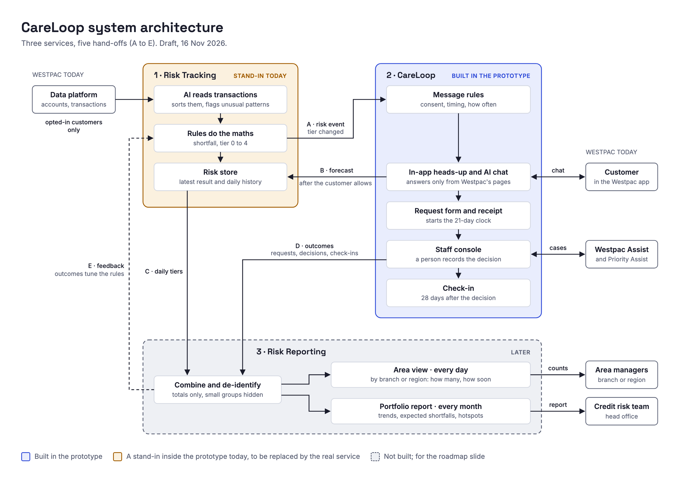

# CareLoop system architecture

Draft for the team, 16 Nov 2026. Timings are proposals, not Westpac's.

CareLoop is three services with five hand-offs between them. Risk Tracking works out who is heading for trouble, CareLoop talks to that customer and gets a request to a person, and Risk Reporting tells Westpac staff what is coming, by area, without names.

The full page, with the same diagram, is [architecture.html](architecture.html) (open it in a browser).

## What each service owns

| Service | Its job | Where the AI is used | In this repository today |
| --- | --- | --- | --- |
| 1. Risk Tracking | For every opted-in customer across Westpac: read the transactions, work out the tier and any shortfall, keep a daily history. | AI sorts transactions and flags unusual patterns. Rules do every calculation. | A stand-in: `lib/tier/` plus pre-sorted sample data. No AI in it yet. |
| 2. CareLoop | Everything the customer and the Assist team touch: heads-up, chat, request, receipt and deadline, staff console, decision, check-in. | AI answers from Westpac's pages, turns the customer's words into form fields and flags sensitive situations. It never calculates or decides. | Built: `lib/conversation/`, `lib/ai/`, `lib/rag/`, `components/`. |
| 3. Risk Reporting | Turn the daily tiers and the outcomes into counts and trends for staff. No names leave this service. | None needed for counting. AI writes the short summary at the top. | A first nightly branch report: `lib/report/` and the **Nightly report** tab of the staff console, counted from the ML service's results for 1,003 synthetic customers in one made-up branch (`data/ml-cohort.json`). No monthly report or trends yet. |

## The five hand-offs

These are the only places where services exchange data, so they are the formats to agree on.

| Arrow | From, to | What is sent | When |
| --- | --- | --- | --- |
| A. Risk event | 1 to 2 | Customer, tier, the reasons in plain words, any shortfall with its date, and the dated facts behind it. | Only when a customer's tier or shortfall changes. |
| B. Forecast | 2 asks 1 | The 14-day balance forecast and its assumptions, for one customer. | The moment the customer taps Allow. |
| C. Daily tiers | 1 to 3 | Each customer's tier and expected shortfall date, with their branch or region. | After every nightly run. |
| D. Outcomes | 2 to 3 | Heads-up sent, request started, decision, check-in result. | As each one happens. |
| E. Feedback | 3 to 1 | How well the tiers predicted real trouble, so thresholds can be adjusted. | After each monthly report. |

## When each part runs

Reporting runs on a clock, straight after the nightly risk run. It is never set off by one customer's action.

| When | What runs | Service |
| --- | --- | --- |
| Every night | Read the day's transactions and recalculate tier and shortfall for every opted-in customer. | 1 |
| Straight after | Refresh the area view: how many customers in each branch or region are expected to fall short in the next 30 days. | 3 |
| Next morning | Send heads-ups to customers whose tier changed. Opening hours only, after payday, at most one a fortnight. | 2 |
| Any moment | Chat, form, filing and the staff queue. "I can't pay" and sensitive disclosures reach staff at once. | 2 |
| On Allow | Fetch that customer's 14-day forecast. | 2 asks 1 |
| Day 28 | Check in with the customer, 28 days after a person recorded an arrangement. | 2 |
| Every month | Portfolio risk report for the credit risk team, then review the rules against what happened. | 3, then 1 |

## Reports by branch: group by area, leave the names out

- Trouble is local (an employer cuts shifts, a flood hits one town), so grouping by branch or region is useful.
- The area view shows counts and timing only, for example "14 customers here are likely to fall short in the next 30 days, up from 6". Groups under 10 are hidden.
- It does not list customers. They agreed to a heads-up for themselves, not to appear on a list staff read.
- Named follow-up goes through CareLoop to Westpac Assist, for customers who started a request, said they cannot pay or asked for a person.

## To settle as a team

- Who builds Risk Tracking, and whether it arrives as a separate server or a module in this repository.
- The exact fields of the risk event (A).
- Whether the forecast comes with the risk event or on request (B).
- Whether Westpac branches look after a set of customers at all, or whether "region" is the realistic grouping. Worth asking a mentor.
- Whether Risk Reporting stays a roadmap slide or gets one screen in the demo.
